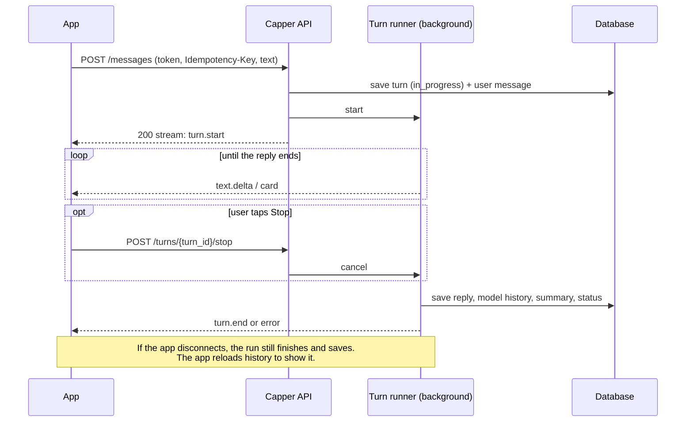

# API contract

The contract between the Carton Caps app and Capper: one continuous
conversation per user, sent as messages and streamed back as events.

The machine-readable version is the generated OpenAPI document. A running
service serves it at `/openapi.json` (interactive at `/docs`), and
[tests/capper/openapi.json](../tests/capper/openapi.json) is a committed
snapshot that a spec keeps in step with the code. This page adds what OpenAPI
can't express: the stream's events, the send rules and the turn outcomes.
[Mobile integration](mobile-integration.md) covers how the app should use it.

## Basics

- **Base path:** `/v1/conversation`. JSON field names are `snake_case`.
- **Times** are ISO 8601 in UTC, for example `2026-11-19T18:03:12.418204+00:00`.
  The app shows them in the user's time zone.
- **The user's time zone** comes from their account (an IANA name such as
  `America/Los_Angeles`; the configured default if it isn't set). Capper uses
  it to tell the model the local time and to interpret dates in a message,
  such as "last Tuesday". The API has no endpoint to set it.
- **IDs** (turns, messages) are opaque strings. Don't parse them.
- **One conversation per user.** There is no conversation ID: the token
  identifies the user, and the user has one continuous conversation.

## Authentication

Every `/v1` request needs the access token the Carton Caps auth API issued:

```http
Authorization: Bearer <token>
```

Capper verifies it locally: an RS256 signature against the auth API's public
key, plus `exp`, `iss` (`carton-caps-auth`) and `aud` (`capper`). The `sub`
claim is the user ID, and the user must exist. Capper keeps no session.

The user ID comes only from the token. No request body, URL or tool argument
can choose a different user. Asking for another user's turn or message
returns `404`, the same as an ID that doesn't exist.

## Errors

Before a response starts streaming, errors are an HTTP status with this body:

```json
{"error": {"code": "turn_in_progress", "message": "another reply is in progress", "turn_id": "9f2c…"}}
```

| Status | `code` | When |
|---|---|---|
| 401 | `not_authenticated` | Missing, malformed, expired or invalid token, or an unknown user. Sent with `WWW-Authenticate: Bearer`. |
| 404 | `not_found` | The turn or message doesn't exist or isn't the caller's. |
| 409 | `turn_in_progress` | Another reply is running for this user. Includes `turn_id`. |
| 422 | `invalid_request` | A field failed validation; `message` names it. |
| 422 | `idempotency_key_reused` | The `Idempotency-Key` was already used with different text. |

Once a send's `200` stream has started, a failure is a single `error` event
instead (see [Events](#events)).

## Endpoints

### `GET /v1/conversation`

What the app needs when the chat opens.

```json
{
  "greeting": [
    "Hi! I'm Capper, your personal Carton Caps assistant.",
    "Ask me a question, and I'll do my best to help you.",
    "If there's anything I can't help you with, I'll direct you to someone who can."
  ],
  "turn_in_progress": false,
  "active_turn_id": null
}
```

- `greeting`: one string per bubble. Show it each time the chat opens. It is
  content, not part of the conversation history, and never sent to the model.
- `turn_in_progress` / `active_turn_id`: whether a reply is still being
  written, for example after the app lost its connection mid-reply.

### `GET /v1/conversation/messages?before=&limit=`

The transcript, newest first.

| Parameter | Default | Notes |
|---|---|---|
| `limit` | 20 | At least 1; values over 100 return 100. |
| `before` | none | The `next_cursor` from the previous page. |

```json
{
  "messages": [
    {
      "id": "b81e…",
      "role": "assistant",
      "created_at": "2026-11-19T18:03:15.902114+00:00",
      "status": "complete",
      "parts": [
        {"type": "text", "text": "Here are this week's Bonus Caps."},
        {"type": "card", "card_type": "promotion", "heading": "This Week's Bonus Caps", "items": [ … ]}
      ]
    },
    {
      "id": "4a07…",
      "role": "user",
      "created_at": "2026-11-19T18:03:12.418204+00:00",
      "status": "complete",
      "parts": [{"type": "text", "text": "Any bonuses going on right now?"}]
    }
  ],
  "next_cursor": "WyIyMDI2LTExLTE5…"
}
```

- `parts` are exactly what the stream sent: text parts (Markdown) and card
  parts, in order. A card part has the same fields as a [`card` event](#card).
- `status` is the status of the message's turn: `in_progress`, `complete`,
  `stopped` or `error`.
- `next_cursor` is `null` on the last page.

### `POST /v1/conversation/messages`

Send a message and stream the reply.

```http
POST /v1/conversation/messages
Authorization: Bearer <token>
Idempotency-Key: 5b0e7c1e-2d1f-4c8e-9a54-3f0f6f1d8a21
Content-Type: application/json

{"text": "My kids are super picky eaters. What can I get that still supports my school?"}
```

- `text`: 1 to 8,000 characters, not just whitespace.
- `Idempotency-Key` (required): up to 200 characters. One key per message the
  user sends; reuse it only to retry that same message. Keys are scoped to the
  user.

The response is `200` with `Content-Type: application/x-ndjson`: one JSON
event per line, ending with exactly one terminal event. Before the stream
starts, the request can fail with:

| Situation | Response |
|---|---|
| Empty or too-long text, missing or invalid key | `422 invalid_request` |
| Another turn is running for this user | `409 turn_in_progress` with its `turn_id` |
| Same key and text, and that turn is still running | `409 turn_in_progress` |
| Same key and text, and that turn has ended | `200`: the saved turn replayed as a short stream, with no new model call |
| Same key, different text | `422 idempotency_key_reused` |

The turn and the user's message are saved before generation starts, so a
crash can't lose the message.

### `POST /v1/conversation/turns/{turn_id}/stop`

Stop a running reply. `turn_id` comes from the stream's `turn.start` event.

- `202 {"stopped": true}`: the reply was running and is now stopping. The
  stream then ends with `turn.end` and `status: "stopped"`.
- `202 {"stopped": false}`: the turn had already ended; nothing to stop.
- `404`: no such turn for this user.

Stopping keeps what was already said and done: the partial reply is saved,
and changes a tool already made (such as a saved note) stay made. The next
message continues the conversation with the stopped turn in context.

### `POST /v1/conversation/messages/{message_id}/feedback`

Rate an assistant message.

```json
{"rating": "down", "comment": "Too long"}
```

- `rating`: `up` or `down`. `comment`: optional, up to 500 characters.
- Returns `200` with `message_id`, `rating`, `comment` and `updated_at`.
- A new rating replaces the previous one.
- `404` for a user message or another user's message.

### Other routes

| Route | Purpose |
|---|---|
| `GET /healthz` | `200 {"status": "ok"}` when the database answers, else `503`. No token. |
| `GET /images/products/{file}` | Product images referenced by cards. |
| `GET /`, `GET /demo/users`, `POST /demo/sessions` | The demo page and its sign-in, which stands in for the auth API. Not part of the app contract. |

## Events

Each line of a send's response is one event with a `type`.

### `turn.start`

Always first.

```json
{"type": "turn.start", "turn_id": "9f2c…", "user_message_id": "4a07…"}
```

Keep `turn_id` for the Stop button.

### `text.delta`

A piece of the reply's Markdown text. Append it to the current text.

```json
{"type": "text.delta", "text": "Here are some participating products "}
```

Markdown is limited to paragraphs, bold, italic, lists and headings. Render it
with raw HTML escaped.

### `card`

Product or promotion cards, in the position they appear in the reply. The
model writes only the `heading` (up to 80 characters) and chooses the IDs;
every item field comes from the database.

```json
{
  "type": "card",
  "card_type": "product",
  "heading": "Picky-eater favorites",
  "items": [
    {"id": 3, "name": "Macaroni & Cheese Box", "price": 9.61, "image_url": "/images/products/macaroni-cheese-box.svg"}
  ]
}
```

| `card_type` | Item fields |
|---|---|
| `product` | `id`, `name`, `price`, `image_url` |
| `promotion` | `id`, `product_id`, `title`, `description`, `image_url` (the product's image) |

`image_url` is a path on the Capper host, or `null`.

### `turn.end` (terminal)

```json
{"type": "turn.end", "status": "complete", "assistant_message_id": "b81e…"}
```

`status` is `complete` or `stopped`. `assistant_message_id` is `null` if the
turn produced no text or cards (for example, stopped before the first word).
The turn is saved before this event is sent, so reloading history afterwards
always shows it.

### `error` (terminal)

```json
{"type": "error", "code": "generic", "message": "Something went wrong and Capper couldn't finish this reply. Please try again."}
```

One generic event for any failure after streaming began: provider errors,
timeouts, limits. What streamed before it is saved, and the turn's status is
`error`. The message never names the provider or the cause; the cause is on
the trace.

## Turn outcomes

Every turn ends one way, and that decides what the stream sent, what is saved
and what a duplicate send replays.

| Outcome | Live stream ends with | Saved | A duplicate send replays |
|---|---|---|---|
| Complete | `turn.end`, `complete` | The assistant message and the model history | `turn.start`, the saved parts, the same `turn.end` |
| Stopped | `turn.end`, `stopped` | Whatever was sent before the stop | `turn.start`, the saved parts, the same `turn.end` |
| Error | `error` | Whatever was sent before the failure | `turn.start`, the saved parts, `error` |
| Interrupted by a restart | (the stream was lost) | Only the user's message; the turn is marked `error` at startup | `turn.start`, `error` |

## Turn lifecycle



## Limits

| Limit | Value |
|---|---|
| Message length | 8,000 characters |
| `Idempotency-Key` length | 200 characters |
| History page size | 20 by default, 100 at most |
| Feedback comment | 500 characters |
| Active turns per user | 1 |
| Turn timeout | 60 seconds |

The message length and turn timeout are settings in
[config.py](../src/capper/config.py); the other limits are fixed in code.

## Not in this contract

- Login, registration and token refresh belong to the existing auth API.
- There's no endpoint to resume a live stream after a disconnect; reload the
  history instead.
- There's no conversation list or "new chat": each user has one
  conversation.
