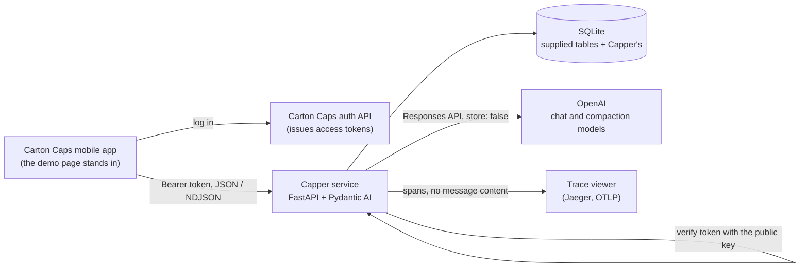
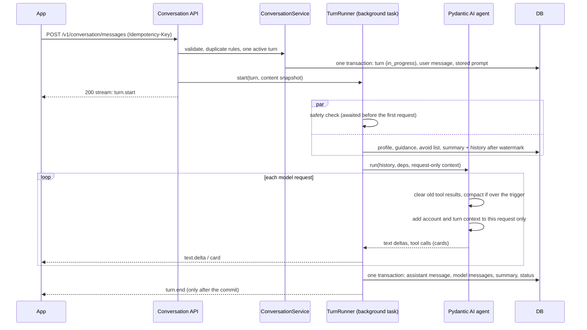
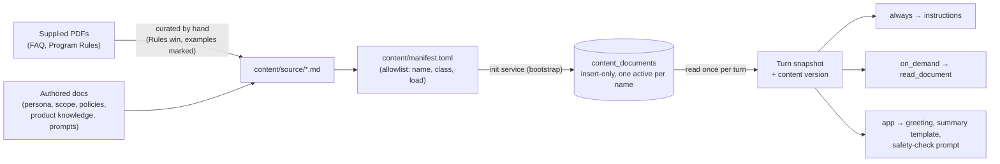
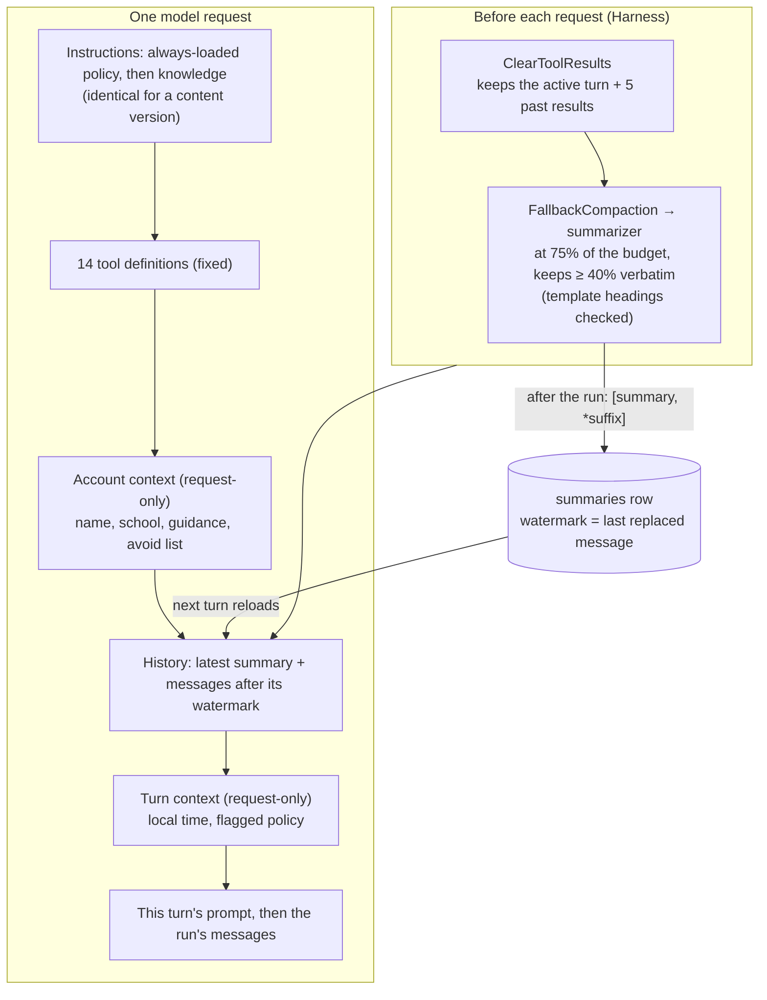

# Build Log

The build of the MVP from `mvp-technical-design-document.md` (TDD), on branch
`build/mvp`. This log records only the key decisions a reviewer might ask us to
defend: where the TDD left a choice open, where a library forced a choice, and
where the build had to correct the TDD. Each entry names the requirement it
touches.

## Library facts confirmed from the installed source

Pydantic AI 2.69 and Pydantic AI Harness 0.69, read before writing code. These
settle Appendix B's verifications.

1. **Capability order (B-1).** The Harness strategies (`ClearToolResults`,
   `FallbackCompaction`) edit history in `before_model_request`, persist the
   edit into the run's history, and replace the request view. A request-only
   injector listed after them sees the compacted request, and its edits never
   reach run history (the Harness documents this placement). `FallbackCompaction`
   re-raises a strategy failure that isn't in `fallback_on`, so a failed summary
   fails the turn. We don't use `TieredCompaction`, whose `skip_on` would skip
   the failure.
2. **Compaction shape (B-2).** `SummarizingCompaction.compact` returns
   `[summary_request, *messages[cutoff:]]` when the first user message isn't
   preserved, user turns aren't kept, and there are no pins, receipts or
   system-prompt parts. That's our configuration, so the kept suffix is a tail
   of the list the run worked on, and the watermark is found by position.
3. **Heading validator (B-3).** The summarizer runs on its own `Agent`, with
   `summarization_capabilities`. A capability's `after_output_process` raising
   `ModelRetry` rejects a summary within the summarizer's `retries`.
4. **Running from a stored prompt (B-4).** A run started with
   `user_prompt=None` and a history ending in a `ModelRequest` sends that
   request as this run's request, and excludes it from `new_messages()`
   (`_first_new_message_index`). The stored prompt isn't duplicated.
5. **Disabling tools for one request (B-5).** `ModelSettings.tool_choice='none'`
   set per request in `before_model_request` keeps the tool definitions and
   lets the model answer only in text. `UsageLimits(request_limit=...)` raises
   `UsageLimitExceeded` as the backstop.
6. **Cancellation (B-7).** `CancellationToken.cancel()` stops a run with
   `RunCancelled`, whose `all_messages()` / `new_messages()` keep the partial
   response and finished tool results. `timeout=` raises `RunTimedOut`, a
   subclass.
7. **Interrupted tool calls.** Pydantic AI closes any tool call left without a
   result with a synthesized `outcome='interrupted'` return *before the history
   is sent to a model*. So API-14's synthetic "not run" result is already the
   framework's behavior: we store the history as it was, and don't write our
   own synthetic results (simplicity over scaffolding).

## Decisions

### Environment and Docker

1. **Pinned images** (ENV-6, ENV-7): `python:3.14.4-slim-bookworm`, `ghcr.io/astral-sh/uv:0.11.16`
   and `jaegertracing/jaeger:2.11.0`. Direct runtime dependencies are pinned exactly in
   `pyproject.toml` as well as locked, since the Harness must be (D-064) and the rest are
   cheap to pin the same way.
2. **Who reads settings** (ENV-5). The service reads `Settings` only in `app.py`. The
   bootstrap and Alembic are their own processes, so each is its own composition root, and
   they read only `StorageSettings` (where the data lives: the database URL and key
   paths). `Settings` extends it, so the defaults live in one place. The evals read
   `Settings` in their entry point.
3. **`otlp_endpoint` may be `None` (no export).** Specs and evals set it, since they run
   without a collector. It's configuration, not a test mode.
4. **`app_version`** (ING-5) is the package version plus the git SHA passed as the
   `GIT_SHA` build argument, when given.
5. **Migration keeps the supplied schema intact** (DATA-17). `image_url` is added and
   removed with native `ALTER TABLE`, not a batch rebuild, which would have dropped the
   supplied table's `AUTOINCREMENT`.
6. *(Superseded by the Docker rework below.)* The first build bind-mounted `./var` and
   needed the host UID at build time.

### Content and data

1. **Authoring notes are stripped at ingestion.** HTML comments in the Markdown sources say
   who authored a document and where it was curated from. They're for people, so
   `normalize()` removes them before hashing and publishing; the model never sees them.
2. **The summary template has a fourth heading, "What happened"** (CNT-1, D-091). D-091's
   three headings (goals and constraints, IDs, open questions) don't carry results, and a
   summary without them loses what was already answered. The required headings are read
   from the template, so the check follows the content.
3. **Instructions order**: within each class, documents are sorted by name, which is
   deterministic for a content version (CTX-1).
4. **Product images are SVG assets in the package** (`capper/catalog/product_images/`),
   served by the app at `/images/products/…`. The supplied catalog has none, so each is an
   illustrative card with the product's name. The first build pointed at an external
   placeholder service; Sam's rule that everything ships inside the image (D-094) replaced
   it, and the seed corrects any older stored URL.
5. **Seed roles** use supplied users 1 and 2 (same school, the cross-account pair) and 3
   (guidance with the allergy note, avoided products), plus one new user with nothing.
   Every user except the new one gets a referral code, because the demo lists every
   user. Purchases come from a fixed random seed, so popularity is reproducible.
6. **Promotions are active relative to when the seed runs** (from 7 days before to 60
   days after), so they're live in a demo.
7. **`publish` commits the session it's given.** The first version opened a nested
   transaction and failed when the caller had already read through the same session.

### Agent, context and compaction

1. **Clearing's trigger** (CMP-3) is the compaction trigger (75% of the budget). The TDD
   didn't set one, and the Harness requires it. Clearing runs first, so a summary happens
   only if clearing wasn't enough.
2. **Background start at 80% of the trigger** (CMP-4): a TDD-level number the decisions
   left open (setting `compaction_background_start`). Removed later with the background
   start itself (D-096).
3. **The budget measures the whole request.** The Harness anchors its count on the
   provider's reported input tokens, which include instructions, tool definitions and the
   request-only blocks. The request-only blocks are never stored or summarized (CTX-2), but
   they do count toward the 75% trigger. CMP-1's "outside the budget" is corrected here.
   With about 3.5k tokens of instructions, a 20k budget leaves room: after compaction,
   about 3.5k fixed + 8k kept + a short summary is under the 15k trigger.
4. **The request-limit backstop is the tool limit + 4, not + 2** (TOOL-4). The summarizer's
   requests count against the run's request limit (Harness behavior), so + 2 could end a
   turn that compacted.
5. **A flagged policy reaches the model `<system>`-framed.** It's a `SystemPromptPart` in
   the turn-context request (CTX-1 step 5). Pydantic AI renders a system part that sits
   mid-conversation as operator-voice text inside the user turn, which is its documented
   convention.
6. **`CapperDeps` carries services, not the session factory and settings** (AGT-6). Tools
   are thin adapters over services (code standard 7.5), so they never need either. The
   limits a tool needs (the tool budget, the result cap) are on deps.
7. **A tool guard capability** implements TOOL-3 (budget, audit, size cap, error results)
   in `wrap_tool_execute`, so every tool gets it without decoration. It adds one entry to
   AGT-7's capability list; it acts on tools, not requests, so its position doesn't affect
   the request order.
8. **Safety check, specs and evals use dependency injection.** `create_app` takes optional
   models, a safety checker and a clock. The eval passes a checker that never flags, so it
   measures the agent's own `read_document` choice (EVAL-1). There's no switch in
   production code (D-007).
9. **History search ORs the quoted terms** (D-074): any term can match, ranked by bm25.
   With AND, a natural-language query rarely matched anything.
10. **The conversation service holds no Pydantic AI types** (STR-2). It stores and loads
    serialized payloads; the runner, which is agent-aware, converts them.

### Docker rework (D-094)

Sam judged the first build's Docker setup a developer workspace: a seven-step,
order-dependent first run, app state in a host-bound `./var` (with the container user's
UID tied to the host), and reset by deleting that folder. His marching order: clear out
the stale environment logic and make Capper a clean, fully Dockerized product. The TDD's
§2 and §2.1 were rewritten to match.

1. **Data in a named volume** (`capper-data` at `/app/data`). The image's user owns the
   mount point, so a fresh volume is writable; no UID build argument. Reset is
   `docker compose down -v`.
2. **An `init` service runs one idempotent bootstrap** (`scripts/bootstrap.py`, replacing
   `init.py` and `ingest.py`): keys, supplied database, migrations, seed, content. The
   service waits for it (`service_completed_successfully`) and only serves. A spec runs
   the bootstrap from nothing, then again, and checks the second run changes nothing.
3. **`GET /healthz`** (API-15) checks the database; Compose health-checks the service
   with it, using Python's standard library (the slim image has no curl).
4. **A `dev` image target** runs specs, checks and evals, so nothing needs a local Python
   setup. It installs `libatomic1`, which the Node that pyright's PyPI wrapper downloads
   needs, and fetches that Node at build time.
5. **Everything ships in the image** (Sam): content, product images, the demo page and
   the supplied database. Nothing is fetched from an external host or mounted from the
   host at runtime. The bootstrap publishes only the content that changed.
   `docker compose run --rm --build init` publishes edited content while the service
   keeps running; it uses the new content from its next turn (ING-3).
6. **Removed:** the `./var` bind mount and its `.gitignore` entry, `APP_UID`, the
   separate `init`/`ingest` script entry points, the no-Docker instructions, and Alembic's
   `prepend_sys_path` (the package is installed in the image).
7. **Environment audit (after the rework).** Removed what only served running outside
   Docker: `.python-version` (the base image pins Python), the `[tool.uv]` default groups
   (the images choose their groups explicitly), `Settings` reading a `.env` file (Compose
   passes it as environment variables), `create_engine` creating the database folder (the
   bootstrap does), the Compose service's duplicate trace endpoint (the setting's default),
   `var` in `.dockerignore`, and the trace collector's port published to the host (only
   containers send traces, over the Compose network). `docs/openapi.json` was stale (no `/healthz`); it now has
   an export script and a spec that fails when it drifts.
8. **A known Compose behavior:** `init` re-runs on every `up`, and because `capper`
   depends on it, `up` also restarts `capper`. Use `run --rm --build init` to publish
   content without a restart.

### Safety check speed (after Sam's test)

Sam's crisis test showed the safety check running but timing out at its 2 s cap, so the
reply waited without the benefit. The main model handled it anyway, by reading the crisis
policy itself as the always-on core instructs. Measured with the real model, eight
messages per run, no timeout:

| Version | Median | Max | Over the 2 s cap |
|---|---|---|---|
| Baseline (output tool, default reasoning) | 1.71 s | 2.96 s | 1 of 8 |
| Reasoning off | 1.24 s | 1.72 s | 0 of 8 |
| Reasoning off + native structured output (kept) | 0.93–1.02 s | 1.04–1.30 s | 0 of 8 |

The flags stayed as accurate across versions. End to end, three turns waited 1.05–1.17 s
for the check, and all three finished with correct flags.

The trace's time to first token previously started *after* the check, which hid up to
2 s of the user's wait. It now counts from the turn's start, and the turn span records
`capper.safety_outcome` and `capper.safety_wait_ms` (OBS-2). A spec checks both, with an
in-memory span exporter that `create_app` accepts by dependency injection, and confirms
no message text reaches any span (OBS-4).

Remaining latency: time to first token was 3.6–7.7 s in those turns. The main model
(reasoning, then tool rounds before its first words) is now the larger share.

## Deviations from the TDD

Each is a choice the build had to make, recorded so the TDD can be updated or the build
changed.

1. **API-14's synthetic "not run" result is the framework's, not ours.** Pydantic AI
   closes an unanswered tool call with an `interrupted` return when the history is next
   sent, so the stored history stays as it happened. A spec stops a turn while
   `get_promotions` is running and shows what is stored and sent:
   - the stored history keeps the unanswered call and the framework's `interrupted`
     state, with no result for the call;
   - the next send carries the framework's interrupted result for it, and the turn
     succeeds.

   API-14 now says this too (D-095).
2. **TOOL-4 backstop + 4** (above).
3. **CMP-1**: request-only blocks count toward the trigger (above).
4. **§13 adds a setting**: `git_sha` (none). (`compaction_background_start` was added
   too, then removed by D-096.)
   The key paths, issuer and audience have defaults (the TDD had listed them as required);
   the bootstrap creates the keys at the default paths, so the first run needs no extra
   configuration. §13 is updated to match.
5. **AGT-6** (services on deps) and **AGT-7** (the tool guard), above.
6. **CNT-1**: the template's fourth heading (above).

## Verification

- **Gates**, run in the `dev` container: `ruff format --check`, `ruff check`, `pyright`
  (strict, over `src`, `scripts`, `tests`, `evals`, `alembic`), `pytest` (97 specs) and
  `pip-audit` all pass.
- **Specs cover TEST-1 to TEST-13** and the migration and seeds. TEST-14 was dropped with
  the control user (D-092). The compaction specs drive real Harness compaction with
  scripted models. That needed a test model that reports realistic input tokens (the
  stock streamed `FunctionModel` reports a fixed 50, which never triggers).
- **EVAL-1** against the real models: 8 of 8 cases passed (five policies fire; three
  unrelated messages read none), both before the rework and in the `dev` container after
  it.
- **ENV-11** (after the rework): on a clean copy of the tree with only `.env` set,
  `docker compose up --build` reached a healthy service, a demo session, a streamed reply,
  and its trace in Jaeger (7 spans; no prompt or reply text in the trace). A second `up`
  reported no changes. The demo page was exercised in a browser: sign-in, history,
  streaming, product and promotion cards, feedback, and Stop.

## Known limitations

1. **SDK retries aren't on the trace** (OBS-3). The OpenAI SDK retries a request before it
   starts, invisibly to us. Summarizer retries do show, as separate summarizer runs.
2. **The demo page keeps the token in memory**, so a reload returns to the user list.

---

# Capper onboarding diagrams

Four views of the system as built (DOC-2, mvp-plan #45). The diagrams are
Mermaid, so they render on GitHub and in most Markdown viewers.

## 1. System context

## 2. One message, from send to saved reply

## 3. The content pipeline

## 4. Context assembly and compaction

---

# Mobile integration notes

How the Carton Caps app should use Capper (DOC-3, mvp-plan #46). The contract
itself is in [`api-contract.md`](api-contract.md).

## Tokens

- Send the access token the app already gets from the Carton Caps auth API, as
  `Authorization: Bearer <token>`, on every `/v1` request.
- A `401` means the token is missing, invalid or expired. Refresh it with the
  auth API and retry.
- Capper keeps no session, so app restarts and token refreshes need nothing
  from Capper.

## Opening the chat

1. Call `GET /v1/conversation` for the greeting and whether a reply is still
   running.
2. Call `GET /v1/conversation/messages?limit=20` for recent history, newest
   first. Page back with `before=<next_cursor>`.
3. Show the date header from message timestamps, in the user's time zone.
4. Show the greeting bubbles each time the chat opens. They're never in
   history.
5. If `turn_in_progress` is true, show the processing state, then reload
   history after a moment.

## Sending and streaming

- Create a random `Idempotency-Key` for each new message. Reuse it only to
  retry that same message, for example after a network error.
- Read the response body as a stream and split it on newlines. Each line is one
  JSON event.
- `turn.start`: keep `turn_id` for the stop button.
- `text.delta`: append to the current text. Split bubbles at blank lines
  (paragraph breaks) and around cards, as the mockups show several short
  bubbles per reply.
- `card`: render a carousel. Products have name, price and image; promotions
  have title, description and the product's image. Image URLs are paths on
  the Capper host: resolve them against the API's base URL.
- `turn.end` or `error`: the reply is finished and saved. Show the feedback
  controls when `assistant_message_id` isn't null.

## Stop, retries and reconnecting

- The send button becomes a stop button while a reply runs. Stop calls
  `POST /v1/conversation/turns/{turn_id}/stop`.
- Leaving the screen or losing the connection doesn't stop the reply. It
  finishes and is saved: reload history to show it. There is no stream resume.
- A `409 turn_in_progress` means another reply is still running. Wait, then
  reload.
- Retrying a finished message with the same key replays the saved reply
  without a new model call.

## Rendering Markdown safely

Text is Markdown: paragraphs, bold, italic, lists and headings. Escape all
HTML before rendering, and never render raw HTML from a reply. Show links as
plain text with their URL, and don't render images from text. Card images come
only from card events.

## Feedback

Thumbs up/down (with an optional comment of up to 500 characters) go to
`POST /v1/conversation/messages/{message_id}/feedback`. A new rating replaces
the previous one.

---

# Privacy considerations

What Capper stores, what it sends, and what it keeps out of logs (DOC-4,
mvp-plan #47). It describes the MVP as built. The privacy system it doesn't
include yet (purging history, targeted redaction) is in
`future-considerations.md` (D-066).

## What Capper stores

All data lives in the service's database, scoped to the user. Every query
filters by the user from the verified token.

| Data | Where | Notes |
|---|---|---|
| The conversation as the user saw it | `messages` (+ `messages_fts` search index) | Append-only. Only text parts are indexed |
| The model's view of the conversation | `model_messages` | Append-only, including tool calls and results |
| Compaction summaries | `summaries` | A summary of older history, written by the compaction model |
| Saved guidance | `guidance_notes` | What the user asked Capper to remember. Removal deletes the row |
| Avoided products | `avoided_products` | Removal deletes the row |
| Ratings and comments | `message_feedback` | One per message; a new rating replaces the old |
| Tool-call audit | `tool_calls` | Arguments with free text (notes, search queries) replaced by their length |
| Turn records | `turns` | Status, model, content version, app version, timings |

Account and turn context (name, school, guidance, avoid list, local time) are
added to each model request but **never stored** in the model history or in
summaries. They're always read fresh from the account data.

Guidance notes can hold sensitive details, such as a health condition, because
users choose what to save. Capper uses them only to personalize replies,
never as a safety guarantee. Removing a note deletes it from guidance. Earlier
chat messages and any existing summary may still mention it, and Capper says
so when removing it (D-051).

## What Capper sends to OpenAI

- Each request sends the instructions, the tool definitions, the account and
  turn context, the summary, and the recent history.
- Requests use `store: false`, so OpenAI doesn't keep response state for
  Capper to retrieve later. OpenAI's own data retention policy for API traffic
  still applies, and is separate (D-052).
- The prompt cache key is an HMAC of the user ID. The internal user ID is
  never placed in the model context.
- The safety check and the summarizer send the user's message and the older
  history, respectively, to the compaction model under the same settings.

Nothing else leaves the service: product images, content and the demo page all
ship inside the image, so the demo page loads nothing from third-party hosts.

## What stays out of logs and traces

- Traces record IDs, counts, token usage, timings and statuses. They never
  include prompts, replies, tool arguments or tool results: the agent's
  instrumentation runs with content capture off (D-079).
- The user appears in traces only as the opaque key.
- Logs are for startup and unexpected errors, and contain no message text.

## Users' data about other people

Users may mention other people, such as a friend they're referring. That text
is stored like any other message and is subject to the same scoping. Nothing
treats it specially in the MVP (D-066).

## The demo sign-in

The demo page's user list lets anyone act as any user. It exists only because
the real auth API isn't available here, and must not ship (D-092).
