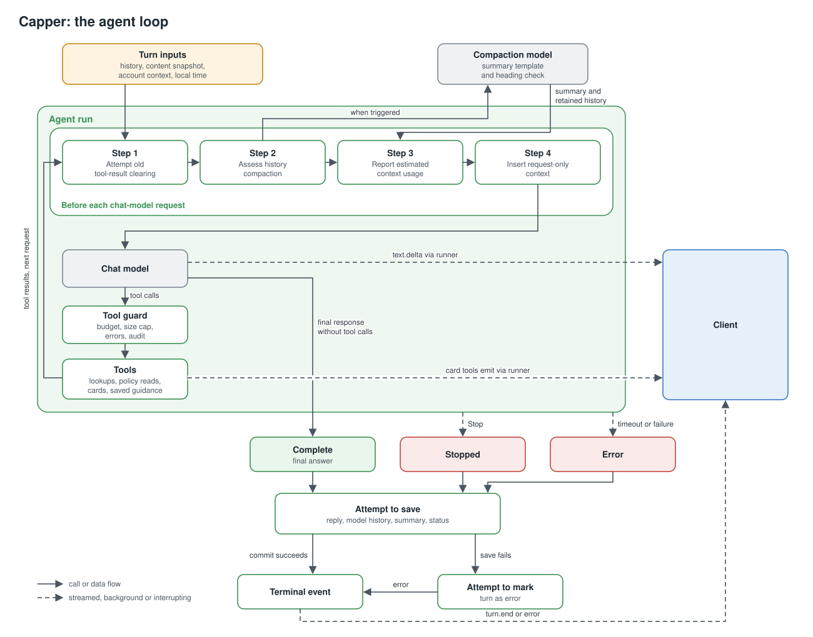
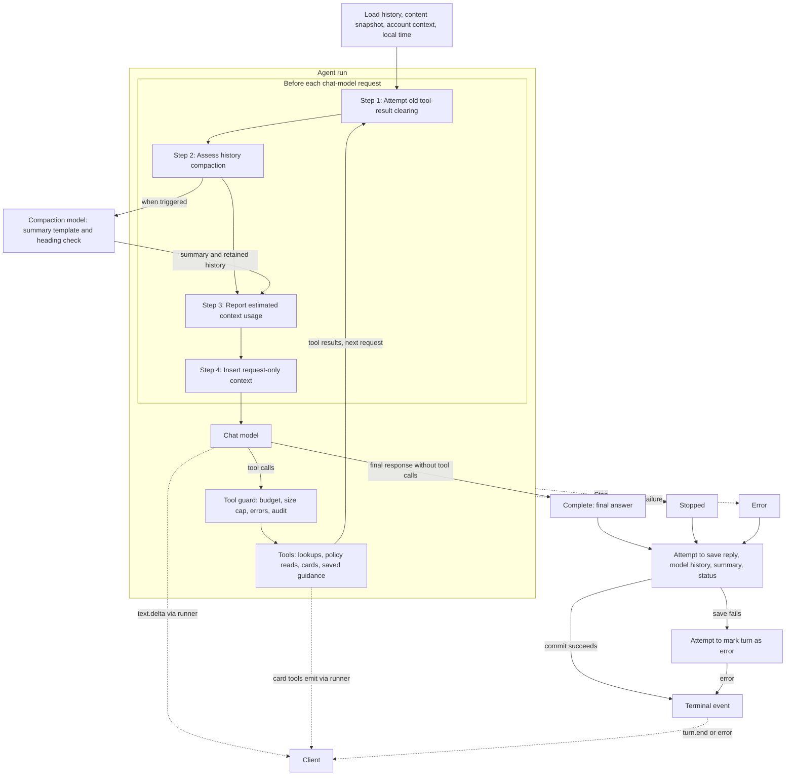

# The agent loop

One turn can contain several model requests and tool calls. The runner loads
its inputs once, starts the agent, streams text and cards, and attempts to save
the final outcome. See the [system overview](system-overview.md) for the API
and storage boundaries around this loop.

The Mermaid source below is the text version of the same diagram.

## Preparing each request

The capabilities run in the order shown above, including after tool results.
These numbers are configurable defaults, defined in
[config.py](../../src/capper/config.py).

| Step | Behavior |
|---|---|
| Clear old tool results | Above an estimated 15,000 tokens, try replacing older tool results with a placeholder while retaining their call arguments. Keep the most recent 15 call/result pairs, enough for the current turn's maximum 10 calls plus five earlier pairs. Skip clearing if it would recover fewer than an estimated 2,000 tokens. |
| Assess compaction | Check the same trigger separately. When summarization is needed, retain a recent history suffix targeting at least 8,000 tokens, with tool exchanges kept together, and summarize older history. A summary missing a required template heading is retried once; another failure fails the turn. |
| Report usage | Emit an estimated context-usage reading against the configured 20,000-token history budget. This happens before request-only context is inserted. |
| Insert context | Add the prebuilt account context before history and local-time context before this turn's prompt. Once the tool budget is exhausted, set `tool_choice` to `none`. |

The 8,000-token setting controls retained recent history; it is not a promise
that the complete request will fit in 8,000 tokens. Context sizing uses the
Harness estimator, with provider-reported usage where available. It is not an
exact count of the final outgoing request or a hard provider context limit.

Account context and local time are built once per turn and inserted again for
each chat-model request. Those injected messages are excluded from persisted
model history and summarization. Underlying guidance records remain stored in
the database; tool exchanges can also contain guidance text.

## Tools and policy reads

All 15 tools pass through the guard. It claims a unit from the turn's tool
budget, converts expected domain errors into model-readable results, rejects
oversized results, and records each execution's outcome and latency with
free-text audit arguments redacted. Unexpected exceptions fail the run.

| Group | Tools |
|---|---|
| Lookups | `search_products`, `get_promotions`, `get_my_purchases`, `get_popular_products`, `get_my_referral_code`, `search_my_history`, `get_my_avoid_list` |
| Policies | `read_document` |
| Cards | `show_products`, `show_promotions` |
| Saved guidance and exclusions | `add_guidance`, `update_guidance`, `remove_guidance`, `avoid_product`, `unavoid_product` |

The always-loaded do-no-harm core instructs the model to read the relevant
policy before answering health or safety questions. The model chooses the
policy and applies it; there is no separate routing model or answer checker.
A successful policy read is audited, but does not establish that the answer
followed it. Card tools separately validate database IDs and exclusions.

## Ending and saving a turn

The defaults allow 10 tool executions, 14 model requests including summarizer
requests, a maximum tool-result size of 8,000 characters, and a 60-second timeout
on the agent run. Stop and timeout can interrupt tool execution or compaction
as well as a chat-model request.

For normal completion, Stop, and handled execution failures, the runner attempts
one final transaction for the assistant transcript, new model messages, any
validly placed summary and its covered-message boundary, and turn status.
`turn.end` reports completion or Stop; `error` reports failure. If the final
save fails, the runner attempts to mark the turn as an error and sends an error
event. A process crash can prevent final saving and event delivery entirely.

Tool writes and audit records commit separately as tools execute. Stopping a
reply retains partial output when saving succeeds and does not undo completed
actions. See [Known limitations](../known-limitations.md) for recovery and
summary-persistence risks.
