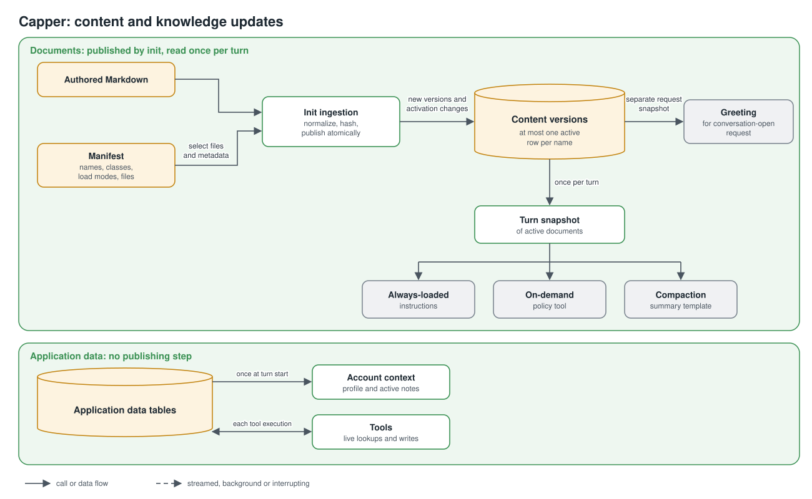
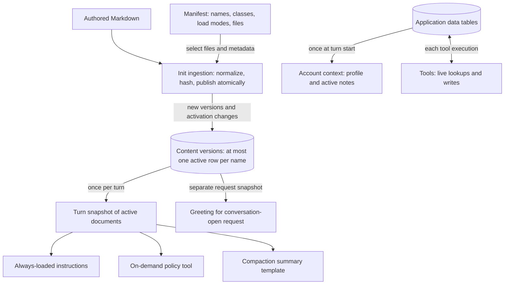

# Content and knowledge updates

Capper publishes authored documents into SQLite and takes a content snapshot
for each turn. Application data follows a separate path: tools query it as
needed, while account context is loaded once at turn start. This implements
the brief's knowledge-update requirement without an administrator UI.

The Mermaid source below is the text version of the same diagram.

## Publishing a change

1. Edit a file under `content/source/`. New documents must also be listed in
   [content/manifest.toml](../../content/manifest.toml); ingestion reads only
   listed sources. The referral FAQ and Program Rules are curated Markdown
   derived from the supplied PDFs, rather than an automated PDF feed.
2. Run `docker compose run --rm --build init`. It rebuilds the image with your
   edits and publishes them without restarting the running app. This also
   reruns key/database setup, migrations, and demo seeding; see the
   [developer reference](../development.md#containers-and-data).
3. Ingestion strips authoring comments and normalizes whitespace. Publishing
   compares each document's name, class, load mode, and normalized-body hash.
   Unchanged documents stay in place. Changed documents get a new row while
   the old row is deactivated; removed documents are deactivated. All these
   changes commit in one transaction.
4. A subsequent turn reads the new active set. A turn already using a snapshot
   keeps that set throughout its model requests, policy reads, and compaction.

Published bodies remain unchanged. A document name has at most one active row;
a removed document has none. Older versions remain available in the table.

## How documents are used

| Load mode | Consumer | Timing |
|---|---|---|
| `always` | Scope, persona, safety core, and business knowledge form the agent's instructions. Operator policies precede user knowledge, with each group ordered by name. | Built from the turn's snapshot and reused throughout the run. |
| `on_demand` | `read_document` returns one of the five detailed safety policies when the model calls it. | The tool reads from the existing turn snapshot. |
| `app` | The compaction summary template supplies the summarizer prompt and required headings. The greeting is returned by `GET /v1/conversation`. | Compaction uses the turn snapshot; the greeting endpoint reads its own request snapshot. |

The active set's content version hashes each document's name, class, load mode,
and body hash. Turns and saved summaries record that version. It identifies
which document set was available, not which policies were actually read or what
live data the tools returned. Tool audits record policy reads separately.
Stable instruction text supports provider prompt caching; it does not guarantee
a cache hit.

## Application data changes

| Data | When the app reads it |
|---|---|
| Products, promotions, purchases, referral codes, and avoided products | Relevant tools query the database when executed. Catalog queries and card validation apply current exclusions and promotion eligibility. |
| Profile and active guidance notes | Loaded once at turn start to build account context, which is reused in outgoing chat-model requests. |
| Guidance and avoid-list edits | Tools save changes immediately and return the result to the model. Account-context guidance refreshes on the next turn; exclusions apply to subsequent catalog/card tool calls. |

Application-data edits do not require content publishing. A new catalog lookup
can observe a database change during a turn, while that turn's document snapshot
and prebuilt account context remain fixed. A reply can also use results already
retrieved earlier in its history. The demo's records are supplied or seeded
locally; this prototype has no live external catalog or account integration.

A production publishing workflow would add editing, review and approval,
evaluation against proposed changes, and rollback. See
[Known limitations](../known-limitations.md) for source-quality and deployment
gaps, and the [system overview](system-overview.md) for the surrounding service.
