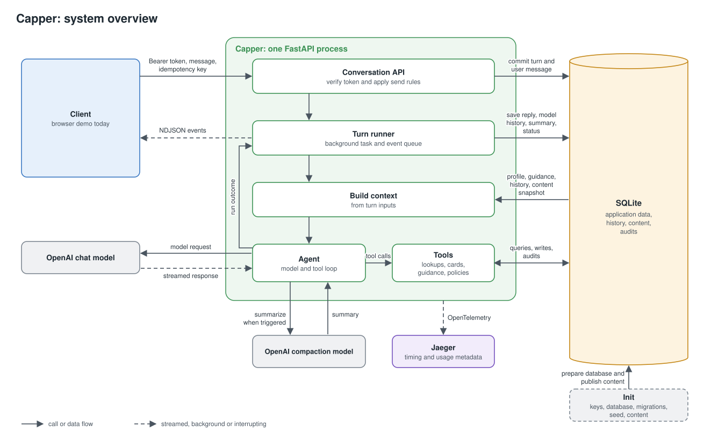
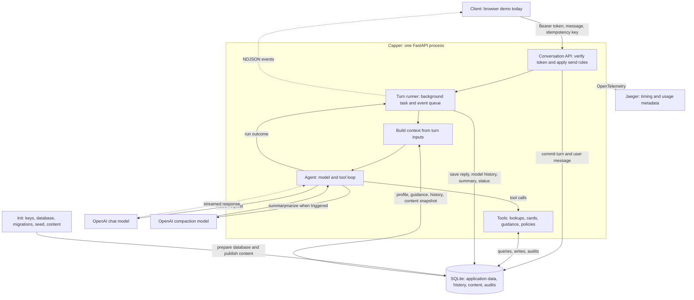

# System overview

Capper runs as one FastAPI process alongside SQLite and a local Jaeger trace
viewer. The browser demo stands in for the Carton Caps mobile client. This
view follows a new message that passes validation; the
[agent loop](agent-loop.md) expands model and tool execution, and
[content updates](content-updates.md) explains document publishing.

The Mermaid source below is the text version of the same diagram.

## How a new message flows

1. The client sends `POST /v1/conversation/messages` with a bearer token and an
   `Idempotency-Key`. Capper verifies the signature and claims, confirms the user
   exists, and derives the user ID from the token.
2. The conversation service validates the message, applies duplicate-send rules,
   and enforces one active turn per user. It commits the turn, user transcript
   message, and model prompt before generation starts.
3. The runner starts a background task. It loads the user's profile, active
   guidance notes, and history. History consists of the latest saved summary
   followed by model messages after its covered-message boundary. The content
   snapshot was read by the API before starting the turn.
4. The agent prepares model requests and executes tools. Text and cards reach
   the client through the runner's event queue. The client stream uses NDJSON;
   the OpenAI response stream is handled separately by the provider adapter.
5. On completion, Stop, or a handled model/tool failure, the service attempts to
   save the reply, new model history, any new summary, and status in one
   transaction. After a successful commit, it sends the terminal event.

## Boundaries that matter

- **Authentication:** the brief assumes an external Carton Caps identity service,
  but this prototype does not integrate with one. Demo account selection issues
  locally signed tokens; protected routes verify them through the normal path.
- **Background execution:** a client disconnect does not cancel generation.
  The task still lives in the application process. A process failure can lose
  an unfinished reply; startup marks abandoned turns as errors without resuming
  them. A failed final save falls back to an attempt to mark the turn as an error.
- **Storage:** the default `capper-data` volume holds SQLite and signing keys.
  Tool writes and audits commit during execution, independently of the final
  reply transaction. Stop does not undo completed writes.
- **Models:** chat and compaction use separately configurable OpenAI models.
  Both opt out of provider response storage. Defaults are in
  [config.py](../../src/capper/config.py).
- **Observability:** turn, agent, model, and tool operations emit trace metadata.
  Message text and tool arguments/results are omitted from traces.

Greeting, history, Stop, and feedback share the conversation API but do not
start this new-message flow. Duplicate sends can replay a finished turn;
invalid requests and conflicting active turns are rejected before generation.
See [the API contract](../api-contract.md) for those paths and
[Known limitations](../known-limitations.md) for deployment boundaries.
